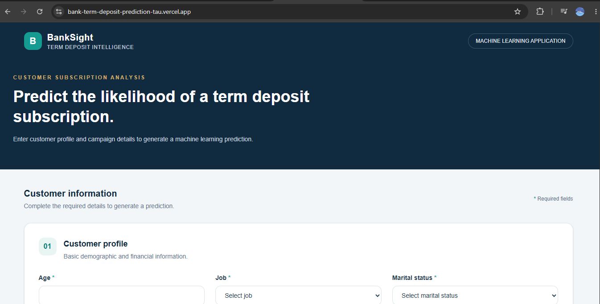
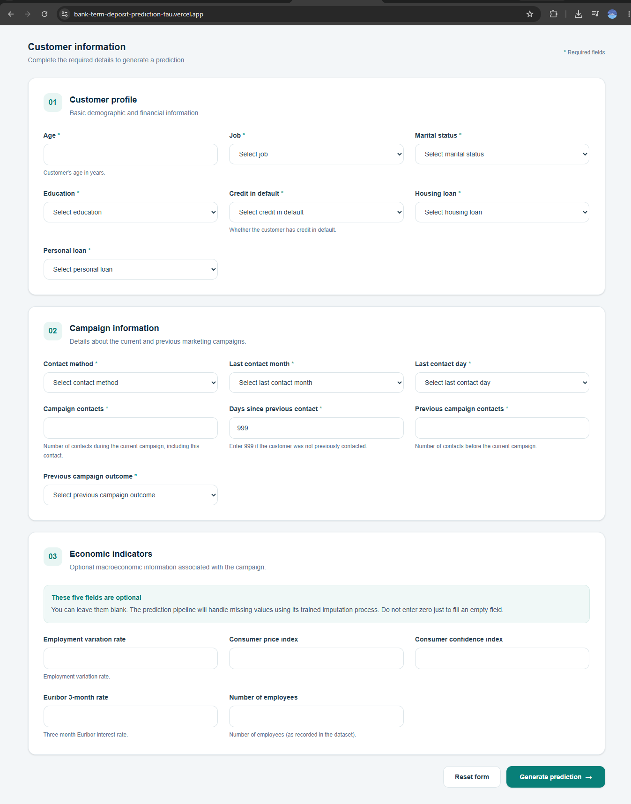
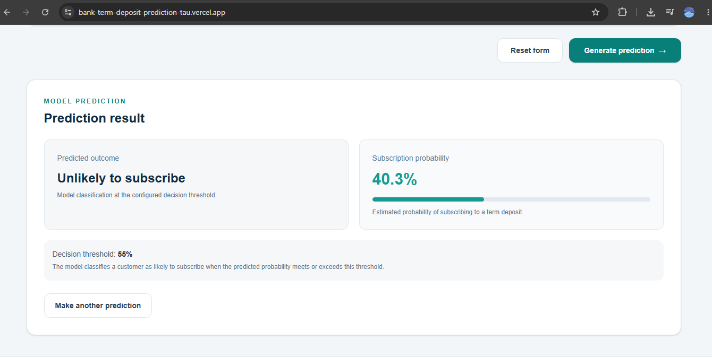

# BankSight — Bank Term Deposit Intelligence

An end-to-end machine learning application that predicts whether a bank customer is likely to subscribe to a term deposit following a marketing campaign.

**[Live Application](https://bank-term-deposit-prediction-tau.vercel.app)** · **[Backend API](https://bank-term-deposit-api-z7b5.onrender.com)** · **[API Documentation](https://bank-term-deposit-api-z7b5.onrender.com/docs)**

**Tech Stack:** Python · Scikit-learn · Pandas · FastAPI · Next.js · React · TypeScript · Tailwind CSS

---

## Contents

1. [Project Overview](#01-project-overview)
2. [Business Problem](#02-business-problem)
3. [Dataset](#03-dataset)
4. [Exploratory Data Analysis](#04-exploratory-data-analysis)
5. [Machine Learning Workflow](#05-machine-learning-workflow)
6. [Model Development](#06-model-development)
7. [Model Performance](#07-model-performance)
8. [Application Architecture](#08-application-architecture)
9. [API Endpoints](#09-api-endpoints)
10. [Technology Stack](#10-technology-stack)
11. [Project Structure](#11-project-structure)
12. [Local Setup](#12-local-setup)
13. [Testing](#13-testing)
14. [Limitations](#14-limitations)
15. [Author](#15-author)

---

## 01. 🎯 Project Overview

**BankSight** is an end-to-end machine learning project developed to predict customer subscriptions to bank term deposits.

The project covers the complete workflow, from data understanding and exploratory analysis to feature engineering, model development, evaluation, API integration and web application deployment.

Unlike a notebook-only machine learning project, the trained model is integrated into a deployed application where users can enter customer and campaign information and receive a subscription prediction.

## 02. Business Problem

Banks conduct marketing campaigns to encourage customers to subscribe to term deposits. However, contacting every customer can be resource-intensive.

The objective is to develop a classification model that identifies customers who are more likely to subscribe, helping make marketing campaign targeting more informed.

The model focuses on identifying positive subscription cases while considering the trade-off between precision and recall.

## 03. 📊 Dataset

The project uses the **Bank Marketing dataset** from the UCI Machine Learning Repository.

| Dataset Attribute | Details |
|---|---|
| Dataset file | `bank-additional-full.csv` |
| Original records | 41,188 |
| Records after duplicate removal | 41,176 |
| Original predictor columns | 20 |
| Predictors used in the primary model | 19 |
| Target variable | `y` |
| Problem type | Binary Classification |

The `duration` feature was excluded from the primary model because call duration is only known after a call has taken place.

**Target distribution:**

- `no` — 88.73%
- `yes` — 11.27%

The dataset is imbalanced, making precision, recall, F1-score and PR-AUC important evaluation measures alongside accuracy.

The raw dataset is not included in this repository. Place `bank-additional-full.csv` inside `data/raw/` before running the notebooks.

## 04. Exploratory Data Analysis

The exploratory analysis examines customer demographics, campaign characteristics, previous contact history and subscription patterns.

Key areas include:

- Distribution of customer and campaign attributes.
- Subscription patterns across categorical and numerical features.
- Class imbalance in the target variable.
- Relationships between previous campaign contacts and subscription outcomes.
- Special handling of `pdays = 999`, representing customers who were not previously contacted.

**Target leakage consideration:** The `duration` feature was excluded because it would introduce information unavailable at the time of pre-call targeting.

## 05. ⚙️ Machine Learning Workflow

| Stage | Process |
|---|---|
| 01 | Data Understanding |
| 02 | Exploratory Data Analysis |
| 03 | Data Cleaning and Preprocessing |
| 04 | Feature Engineering |
| 05 | Model Training and Cross-Validation |
| 06 | Threshold Evaluation and Selection |
| 07 | Model Serialization |
| 08 | API Integration and Deployment |

### Data Preprocessing and Feature Engineering

- Removed 12 exact duplicate records.
- Used stratified train-test splitting with an 80:20 ratio.
- Applied median imputation and standard scaling to numerical features.
- Applied most-frequent imputation and one-hot encoding to categorical features.
- Engineered `pdays_contact_recorded` to capture previous contact history.
- Replaced the special `pdays = 999` marker with a missing value for preprocessing.
- Used a scikit-learn pipeline to combine preprocessing and classification.

## 06. Model Development

The following classification algorithms were evaluated:

| Model | Evaluation |
|---|---|
| Dummy Classifier | Baseline |
| Logistic Regression | Standard and class-weight balanced |
| Decision Tree | Standard and class-weight balanced |
| Random Forest | Standard and class-weight balanced |
| Gradient Boosting | Standard |

Class-weight balancing was explored to address the imbalanced target distribution.

**Selected classifier: Balanced Logistic Regression**

A decision threshold of **0.55** was selected as a recall-oriented precision-recall compromise. It retained recall above 60% while improving the F1-score compared with the default 0.50 threshold.

The threshold was selected based on model evaluation rather than a validated business-profit optimization.

## 07. 📈 Model Performance

The final selected pipeline was evaluated on the held-out test set using a decision threshold of 0.55.

| Metric | Test Score |
|---|---:|
| Accuracy | 84.65% |
| Precision (Yes) | 38.87% |
| Recall (Yes) | 63.25% |
| F1-score (Yes) | 48.15% |
| ROC-AUC | 0.8001 |
| PR-AUC | 0.4459 |

### Confusion Matrix

| Actual / Predicted | No | Yes |
|---|---:|---:|
| No | 6,385 | 923 |
| Yes | 341 | 587 |

**Interpretation:** The model identifies approximately 63% of actual subscribers in the test set. Its lower positive-class precision indicates that some customers predicted as subscribers do not ultimately subscribe.

The selected threshold reflects a recall-oriented trade-off, not a guarantee of campaign profitability.

## 08. 🏗️ Application Architecture

The trained machine learning pipeline is integrated into a web application through a FastAPI backend.

### Prediction Flow

1. User enters customer and campaign information through the web interface.
2. The Next.js frontend sends the input to the backend API.
3. FastAPI validates the incoming data.
4. The serialized scikit-learn pipeline processes the features and generates a prediction.
5. The API returns the prediction and associated probability to the frontend.
6. The application displays the prediction result.

### Application Components

**Machine Learning Pipeline**
- Serialized using Joblib.
- Includes preprocessing and the selected classifier.
- Applies the engineered feature logic and selected decision threshold.

**Backend — FastAPI**
- Loads the trained pipeline.
- Validates incoming customer and campaign data.
- Exposes prediction and health-check endpoints.
- Returns prediction results through a REST API.

**Frontend — BankSight**
- Built using Next.js, React, TypeScript and Tailwind CSS.
- Provides an interface for entering customer and campaign information.
- Communicates with the backend API.
- Displays the resulting subscription prediction.

**Deployment:** Frontend hosted on Vercel; backend hosted on Render.

## 09. Application Screenshots

### Homepage



### Prediction Input



### Prediction Result



## 10. API Endpoints

| Method | Endpoint | Description |
|---|---|---|
| GET | `/` | API welcome message |
| GET | `/health` | API and model health check |
| POST | `/predict` | Generate a subscription prediction |

Interactive API documentation is available through the deployed [Swagger UI](https://bank-term-deposit-api-z7b5.onrender.com/docs).

## 11. Technology Stack

| Category | Technologies |
|---|---|
| Programming Language | Python |
| Data Analysis | Pandas, NumPy |
| Data Visualization | Matplotlib, Seaborn |
| Machine Learning | Scikit-learn, Statsmodels |
| Notebook Environment | Jupyter Notebook |
| Model Serialization | Joblib |
| Backend | FastAPI, Pydantic, Uvicorn |
| Frontend | Next.js, React, TypeScript |
| Styling | Tailwind CSS |
| Testing | Pytest, HTTPX |
| Deployment | Render, Vercel |
| Version Control | Git, GitHub |

## 12. 📁 Project Structure

```text
bank-term-deposit-prediction/
│
├── backend/
│   ├── app/
│   │   ├── __init__.py
│   │   ├── main.py
│   │   └── schemas.py
│   └── requirements.txt
│
├── data/
│   ├── raw/
│   └── processed/
│
├── frontend/
│   ├── public/
│   ├── src/
│   │   └── app/
│   ├── package.json
│   └── package-lock.json
│
├── models/
│   └── bank_term_deposit_pipeline.joblib
│
├── notebooks/
│   ├── 01_data_understanding.ipynb
│   ├── 02_eda.ipynb
│   ├── 03_preprocessing.ipynb
│   └── 04_model_training.ipynb
│
├── reports/
│   └── figures/
│
├── src/
│   └── bank_marketing/
│
├── tests/
│   └── test_api.py
│
├── .gitignore
├── .python-version
├── requirements.txt
└── README.md
```

## 13. 🚀 Local Setup

### 1. Clone the repository

```bash
git clone https://github.com/pulkitn-analytics/bank-term-deposit-prediction.git
cd bank-term-deposit-prediction
```

### 2. Create and activate a virtual environment

```bash
python -m venv .venv
```

**Windows PowerShell:**

```powershell
.\.venv\Scripts\Activate.ps1
```

### 3. Install Python dependencies

```bash
pip install -r requirements.txt
```

### 4. Add the dataset

Place `bank-additional-full.csv` inside:

```text
data/raw/
```

### 5. Start the backend

From the project root:

```bash
uvicorn backend.app.main:app --reload
```

Backend runs at `http://127.0.0.1:8000`.

API documentation: `http://127.0.0.1:8000/docs`

### 6. Start the frontend

Open a separate terminal:

```bash
cd frontend
npm install
npm run dev
```

Frontend runs at `http://localhost:3000`.

Configure the frontend's backend API URL according to the application's environment configuration before running it locally.

## 14. Testing

Backend API tests are implemented using Pytest and FastAPI TestClient.

Run from the project root:

```bash
pytest -v
```

The API test suite covers valid predictions, missing required fields and optional macroeconomic inputs.

## 15. Limitations

- The model is trained on historical bank marketing data and may not generalize to different customer populations or campaign conditions.
- The target variable is imbalanced; accuracy alone does not adequately represent positive-class performance.
- The selected decision threshold is an evaluation-based trade-off, not a validated business decision rule.
- Predictions are probabilistic estimates and should not be interpreted as guaranteed customer behavior.
- This is a portfolio project, not a production banking decision system.

---

## 16. Author

**Pulkit Narang**

Data Science | Machine Learning | AI Applications

[GitHub Profile](https://github.com/pulkitn-analytics) · [Project Repository](https://github.com/pulkitn-analytics/bank-term-deposit-prediction)